# EP-P5400 분석 단계

> 표기 규칙: **[확인]** = 분해기/데이터시트로 확인된 사실, **[추정]** = 동일 계열 칩 데이터시트로부터의 추론.
> 모든 시각자료는 `figures/`, 원문 데이터시트는 `refs/`에 저장.

## Step 0. Product
- EP-P5400 (Samsung Super Fast Wireless Charger Duo, 2022)
- 15W 출력 (좌측 패드: 스마트폰 15W / 우측 패드: Galaxy Watch·Buds 전용)
- 2대 동시 충전
- 입력: USB-C 9V 2.77A (25W TA 동봉), 내장 냉각팬

## Step 1. Design Challenge
1. 충전 효율 :
    (무선 충전 과정에서 발생하는 전력 손실, 코일 간 거리 및 정렬에 따른 효율 변화 등)
    입력 전력과 수신 전력을 비교해 충전 효율을 계산하고, 효율에 영향을 주는 요인을 분석
2. 발열 관리 :
    (발열이 충전효울과 성능에 미치는 영향, 삼성 모델에 내장된 냉각팬의 역할)
    전력 손실이 열로 발생하는 원리를 설명하고, 냉각팬과 회로 설계로 발열을 관리하는 방법 분석

### Step 1 → Step 2~4 연결 (분석 질문)
| Challenge | Step 2에서 볼 것 | Step 3에서 볼 것 | Step 4에서 볼 것 |
|---|---|---|---|
| 충전 효율 | 전력이 거치는 변환 단(DC-DC → DC-AC → 자기결합 → AC-DC)별 손실 | MP28167-A 효율, VS3618AE RDS(on), P9236의 FOD/전력제어 | 공진 주파수·위상(ZVS)·결합계수 k·임피던스 |
| 발열 관리 | 손실 → 열 → 온도센서(NTC) → 팬/전력제한 루프 | G761 팬 컨트롤러, OTP/OCP 보호 | 도통손실 I²R, 스위칭손실, 코일 ESR, 공진 커패시터 전압 |

**측정 데이터 [확인]** (ChargerLab, 입력측 USB-C 측정)

| 조건 | 입력 전력 |
|---|---|
| 대기 | 0.65 W |
| Galaxy S22+ | 19.56 W |
| AirPods 3 | 2.93 W |
| S22+ + AirPods 3 | 17.75 W |

→ 수신측 15 W라 가정하면 **η ≈ 15 / 19.56 ≈ 77 % (상한)**, **손실 ≈ 4.5 W 이상이 열**로 발생. 이것이 팬(5 V 0.31 A, 최대 1.55 W)이 필요한 이유.

---

## Step 2. Block Diagram

### 2-0. System Level · Main Block — 효율–발열 결합 루프
> Step 1의 두 과제(효율, 발열)를 하나의 루프로 보고, 이를 **메인 블록**으로 삼는다. 이후 모든 회로는 "이 루프의 어느 지점을 끊는가"로 설명한다.

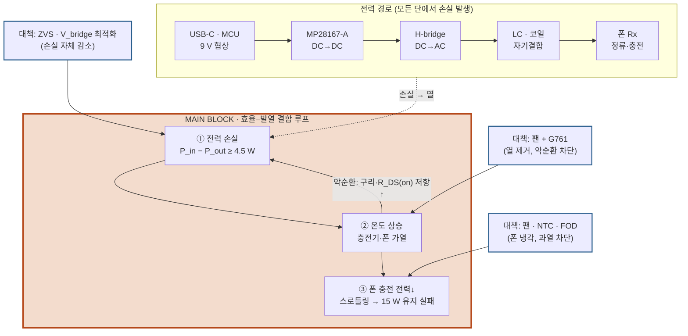

| 루프 지점 | 무엇이 일어나는가 | 끊는 회로 블록 |
|---|---|---|
| ① 손실 | 모든 변환 단의 손실이 합쳐짐 (≥4.5 W) | ZVS(H-bridge), Vbridge 최적화(MP28167-A + IDTP9236 CEP 루프) |
| ② 온도 | 손실 = 열 → 충전기·폰 가열 / 온도↑ → 저항↑ → 손실↑ (양의 피드백) | 팬 + G761 폐루프 속도 제어 |
| ③ 폰 스로틀링 | 폰이 배터리 보호로 충전 전력을 낮춤 | 팬(폰 표면 냉각), NTC 과열 차단, FOD |

### 2-1. 시스템 블록 다이어그램 (분해 결과 기반)
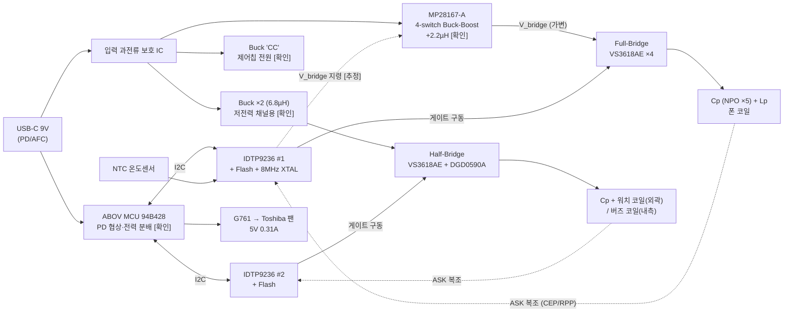

### 2-2. 전력 경로별 손실 지점 (효율 분석용)
| 단 | 블록 | 주요 손실 메커니즘 | 비고 |
|---|---|---|---|
| ① | USB-C 입력, OCP | 커넥터·트레이스 저항 | 9 V 입력으로 전류↓ → I²R 감소 |
| ② | DC-DC (MP28167-A) | 스위칭손실, 인덕터 DCR, MOSFET RDS(on) | 데이터시트 효율 ~95 % 영역 |
| ③ | DC-AC 인버터 (H-bridge) | 도통손실, 스위칭손실(ZVS 여부), 데드타임 | 127.7 kHz 고정 [추정] |
| ④ | 자기결합 (Tx↔Rx 코일) | 코일 ESR, 누설자속, 와전류(FOD), k 감소 | **거리·정렬 의존 → 최대 손실원** |
| ⑤ | Rx 정류·레귤레이션 (폰 내부) | 정류 손실, LDO 손실 | CEP로 최소화 |

### 2-3. 피드백 루프 (전력 제어 + 열 제어)
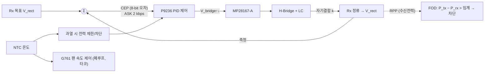
- 고정주파수(MP-A11) 모드: **주파수 대신 브리지 입력전압(V_bridge)을 조절**해 전력 제어 (P9243-GB 데이터시트 §8)
- 가변주파수(BPP) 모드: 110–205 kHz 범위에서 주파수↓ → 전력↑

---

## Step 3. Chips

| # | 칩 | 제조사 | 기능 | 핵심 사양 | 패키지 | 근거 |
|---|---|---|---|---|---|---|
| 1 | **IDTP9236** ×2 | Renesas (구 IDT) | Qi Tx 컨트롤러 SoC (패드별 1개) | Cortex-M0, FET 드라이버 내장, ASK 복조/FSK 변조, FOD, 외부 Flash 펌웨어 | QFN | [확인] 분해 / 공개 데이터시트 없음 → **P9243-GB로 대체 분석 [추정]** |
| 2 | **MP28167-A** | MPS | 4-switch Buck-Boost (브리지 전압 생성) | VIN 2.8–22 V, 3 A, 500/750 kHz, I²C로 VREF 0.08–1.637 V (0.8 mV 분해능), CC 전류제한, OVP/OCP/OTP | QFN-16 3×3 | [확인] 데이터시트 |
| 3 | **VS3618AE** ×4(+α) | Vergiga (Vanguard) | H-bridge 파워 MOSFET | N-ch 30 V, 6.4 mΩ(분해기 기재), PDFN3333 | PDFN3333 | [확인] 분해 |
| 4 | **DGD0590A** | Diodes | 하프브리지 게이트 드라이버 (보드 뒷면) | 40 V 부트스트랩, 5 V 게이트, 전파지연 16/12 ns, UVLO 3.4 V | V-QFN3030-8 | [확인] 데이터시트 |
| 5 | **ABOV 94B428** | ABOV | 시스템 MCU: USB PD 협상, 양 패드 전력 분배 | PD3.0 인증 | – | [확인] 분해 (데이터시트 비공개) |
| 6 | **G761** | GMT | 팬 속도 컨트롤러 | 개루프/폐루프(타코) 지원 | – | [확인] 분해 |
| 7 | **S3FW6MA** | Samsung | 삼성 커스텀 칩 (기능 미공개) | – | – | [확인] 분해, 기능 [미상] |
| 8 | 기타 | – | 8 MHz 크리스털, 외부 Flash ×2, Buck ×3, 입력 OCP IC, NPO 공진 커패시터 | – | – | [확인] 분해 |

### IDTP9236 ≈ P9243-GB로 보는 근거 [추정]
| P9243-GB 데이터시트 특징 | EP-P5400 분해 소견 |
|---|---|
| "Samsung Fast Charge" 지원, 15 W EPP | 삼성 15 W 충전기 |
| 외부 Flash에 애플리케이션 펌웨어 저장 | IDTP9236마다 외부 메모리 1개씩 |
| 127.7 kHz 고정주파수 → 외부 오실레이터 필요 | 8 MHz 크리스털 존재 |
| 외부 step-down 레귤레이터로 브리지 전압 제어 | MP28167-A + 2.2 µH가 브리지 전원 |
| MP-A11 코일: Lp=6.3 µH ±10 %, Cp=500 nF | NPO 커패시터 5개 병렬 (폰 코일) |

### 반도체소자 관점 포인트 (반도체공학개론 연결)
- **파워 MOSFET**: RDS(on)(도통손실 I²R) vs Qg(스위칭손실) 트레이드오프, 트렌치 구조, 바디다이오드(데드타임 중 도통)
- **SoC 통합**: Cortex-M0 + 아날로그(복조기, 전류센스앰프, LDO, 내부 Buck) + 게이트 드라이버를 단일 다이에 집적 → 보드 면적·BOM 감소
- **부트스트랩 게이트 드라이브**: 하이사이드 N-MOSFET 구동을 위해 VGS를 플로팅 전원으로 생성
- **4-switch Buck-Boost**: VIN(5/9 V)에 무관하게 필요한 Vbridge 생성 (buck/boost/buck-boost 모드 자동 전환)

---

## Step 4. Circuit Spotlight

### 4-1. MOSFET H-Bridge (DC → AC 인버터)
- 구성 [확인]: VS3618AE ×4 = Full-bridge (폰), DGD0590A 구동 Half-bridge (워치/버즈)
- 동작: 대각 MOSFET 쌍(Q1·Q4 ↔ Q2·Q3)을 교대로 ON → LC 탱크에 ±Vbridge 구형파 인가
- Full vs Half: Full-bridge는 같은 Vbridge에서 2배 전압 진폭(4배 전력) → 15 W 폰 채널에 사용, 저전력 웨어러블은 Half-bridge
- 손실: Pcond = Irms²·RDS(on), Psw ∝ V·I·(tr+tf)·fsw → **ZVS 달성 시 Psw ≈ 0**
- 데드타임: 상·하 MOSFET 동시 ON(관통전류) 방지, DGD0590A 전파지연 매칭(16/12 ns)이 중요

### 4-2. LC 공진회로
- 직렬 공진: f0 = 1/(2π√(LpCp)) = 1/(2π√(6.3 µH × 500 nF)) ≈ **89.7 kHz**
- 동작 주파수 127.7 kHz > f0 → **유도성 영역에서 동작** → 전류가 전압보다 뒤짐 → MOSFET 턴온 전 바디다이오드 도통 → **ZVS**
- 공진 시 Cp 양단 전압 최대 ~70 V → 100 V급 **C0G/NPO** 커패시터 사용 (온도·DC바이어스 안정, 저 ESR) [확인: 분해에서 NPO 확인]
- Q-factor: Q = ωL/R → 높을수록 효율↑, 그러나 FOD 판단에도 사용 (금속 이물질 시 Q 하락)

### 4-3. 핵심 개념 정리
| 개념 | EP-P5400에서의 의미 | 수식/지표 |
|---|---|---|
| 전자기학 (상호유도) | Tx 코일 교류자속이 Rx 코일에 기전력 유도 | Vrx = jωM·Itx, k = M/√(L1L2) |
| 결합계수 vs 거리/정렬 | 거리↑·오정렬↑ → k↓ → 효율↓, 전류↑ → 발열↑ | ηmax = k²Q1Q2/(1+√(1+k²Q1Q2))² |
| 주파수 응답 | 공진점 근처에서 코일전류 최대, 부하(Req)에 따라 피크 완만 | \|I\|/V = 1/\|R + j(ωL − 1/ωC)\| |
| 페이즈 매칭 | 전압-전류 위상차가 ZVS 여부와 무효전력 결정 | ∠Zin > 0 (유도성) → ZVS |
| 임피던스 매칭 | 반사 임피던스 Zref = (ωM)²/Zrx를 Cp 선택으로 보상 → 최대 전력 전달 | Rx 측 최적부하 RL,opt |
| 피드백 | Rx가 CEP로 오차 전송 → Tx가 Vbridge 조절 (수렴 ~90 ms) | 8-bit signed CEP |
| 통신 (ASK/FSK) | Rx→Tx: 부하변조 ASK 2 kbps, Tx→Rx: FSK | 전압·전류 동시 복조 |
| FOD | 전력손실(Ptx−Prx) 및 Q 변화로 금속 이물질 감지 → 와전류 발열 방지 | RPP 패킷 |

---

## 조사 자료 ↔ 시각자료 대응표

| # | 조사 항목 (M) | 유형 | 출처 | 시각자료 (N) |
|---|---|---|---|---|
| 1 | 제품 내부 구조 (PCBA + 팬 배치) | 분해 | [ChargerLab teardown](https://chargerlab.com/teardown-of-samsung-15w-faster-wireless-charger-duo-ep-p5400) |  |
| 2 | 실제 PCB 전면 (칩 배치) | 실제 회로 | ChargerLab |  |
| 3 | 송신 코일 구조 (워치 외곽/버즈 내측) | 전자기학 | ChargerLab |  |
| 4 | IDTP9236 실장 | 칩 | ChargerLab |  |
| 5 | ABOV MCU 실장 | 칩 | ChargerLab |  |
| 6 | MP28167-A 실장 | 칩 | ChargerLab |  |
| 7 | VS3618AE H-bridge 실장 | 회로 | ChargerLab |  |
| 8 | NPO 공진 커패시터 | 회로 | ChargerLab |  |
| 9 | DGD0590A 게이트 드라이버 (뒷면) | 칩 | ChargerLab |  |
| 10 | G761 팬 컨트롤러 (열관리) | 칩 | ChargerLab |  |
| 11 | P9243-GB 데이터시트 (P9236 대체) – 응용회로 | 데이터시트 | [refs/P9243-GB.pdf](refs/P9243-GB.pdf) p.1 |  |
| 12 | Tx SoC 내부 구조 (SoC-level 블록) | SoC | P9243-GB Fig.15 |  |
| 13 | Tx SoC 패키지/핀 배치 (SoC 물리 레이아웃 대용) | SoC layout | P9243-GB Fig.1 |  |
| 14 | Tx 레퍼런스 회로도 (회로 scheme) | 회로도 | P9243-GB Fig.28 |  |
| 15 | LC 공진회로 + Full-bridge 응용도 | 회로 | [refs/P9242-R3.pdf](refs/P9242-R3.pdf) Fig.18 |  |
| 16 | 코일 정렬(XY)별 효율 맵 | 효율 | P9243-GB Fig.3 |  |
| 17 | ASK 복조 신호 (피드백 통신) | 피드백 | P9243-GB Fig.11 |  |
| 18 | WPC 전력전송 단계 흐름 (제어 상태도) | 다이어그램 | P9243-GB Fig.16 |  |
| 19 | Q-factor 기반 FOD | 발열/안전 | P9243-GB Fig.27 |  |
| 20 | 4-switch Buck-Boost 토폴로지·동작영역 | 데이터시트 | [refs/MP28167-A.pdf](refs/MP28167-A.pdf) Fig.2–3 |  |
| 21 | DC-DC 피드백 네트워크 | 피드백 | MP28167-A Fig.15 |  |
| 22 | 보드 레벨 레이아웃 (전력단 PCB) | layout | MP28167-A Fig.16 |  |
| 23 | 하프브리지 드라이버 내부 블록 | 데이터시트 | [refs/DGD0590A.pdf](refs/DGD0590A.pdf) p.2 |  |
| 24 | 주파수 응답 (LC 공진 곡선) | 개념 | 데이터시트 L/C 값으로 계산 | 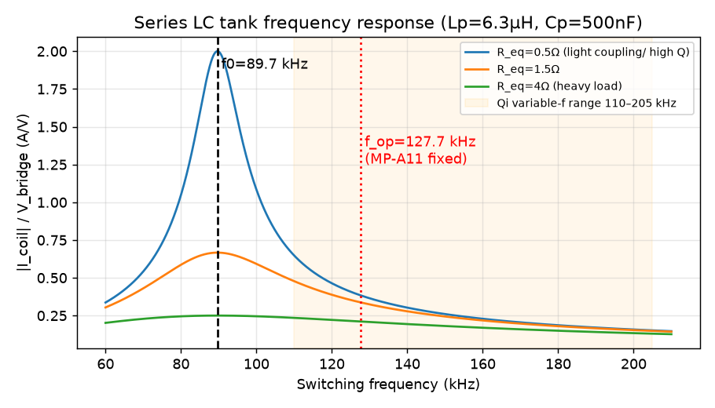 |
| 25 | 페이즈 매칭 / ZVS | 개념 | 데이터시트 L/C 값으로 계산 | 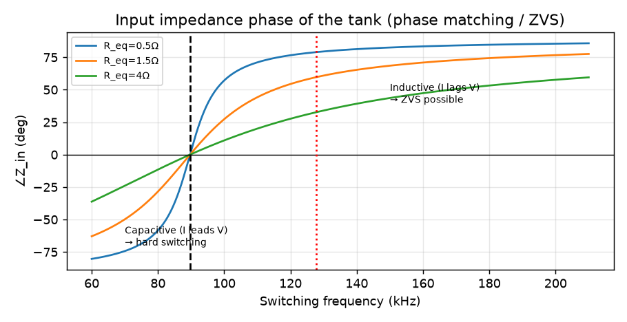 |
| 26 | 임피던스 매칭 / 결합계수-효율 | 개념 | ηmax(k,Q) 식으로 계산 | 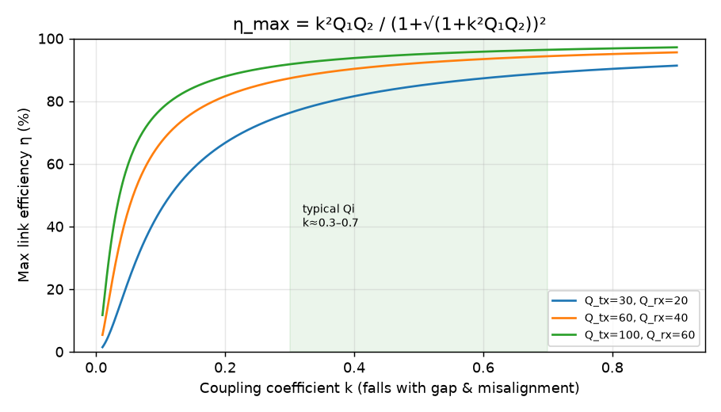 |
| 27 | 결합계수 vs 거리·오정렬 실측 (논문) | paper | Domajnko et al., *Sensors* 22(4):1445, 2022, [doi:10.3390/s22041445](https://doi.org/10.3390/s22041445) | [Fig.9–12 (PMC)](https://pmc.ncbi.nlm.nih.gov/articles/PMC8876809) — k: 10 mm에서 0.73 → 58 mm에서 0.15, 25 mm 오정렬 시 60 % 이상 감소 |
| 28 | 실측 입력전력 (효율 계산 근거) | 측정 | ChargerLab 데이터 | 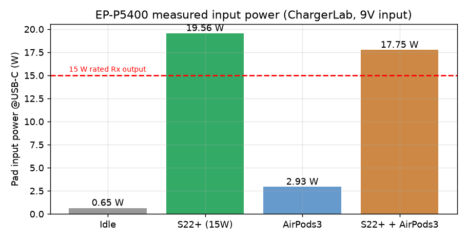 |
| 29 | 시스템 블록 다이어그램 | 다이어그램 | 위 1~23 종합 | §2-1 Mermaid 다이어그램 |
| 30 | 전력·열 피드백 블록 | 다이어그램 | P9243-GB §8, MP28167-A, G761 | §2-3 Mermaid 다이어그램 |

| 31 | Planar vs Trench MOSFET 구조 | 반도체소자 | 개념도 (Baliga 참고) | 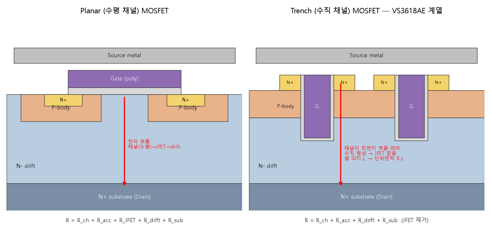 |
| 32 | MOSFET 출력특성 / RDS(on) | 반도체소자 | square-law 모델 | 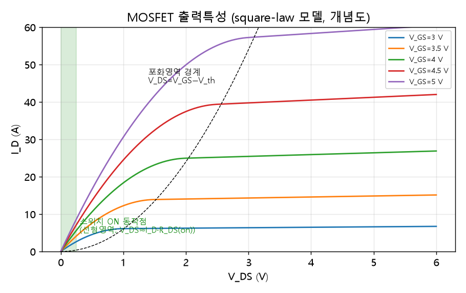 |
| 33 | 게이트 전하 (Miller plateau) | 반도체소자 | 개념도 (Qg 가정) | 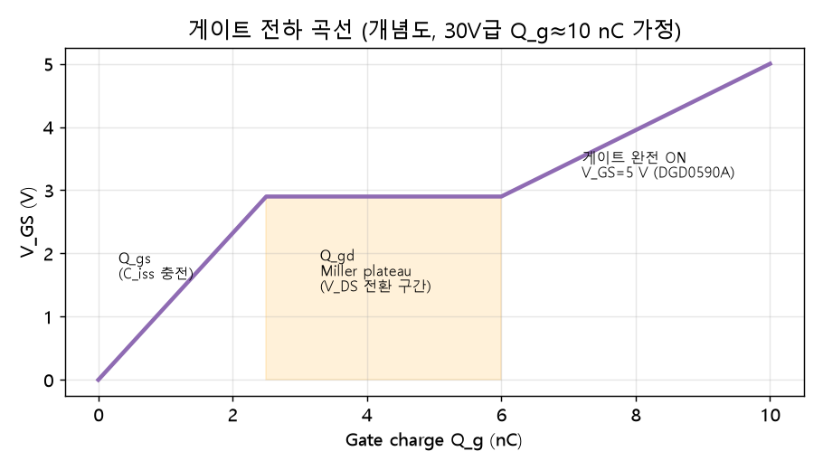 |
| 34 | ZVS 스위칭 파형 | 반도체소자 | 개념도 | 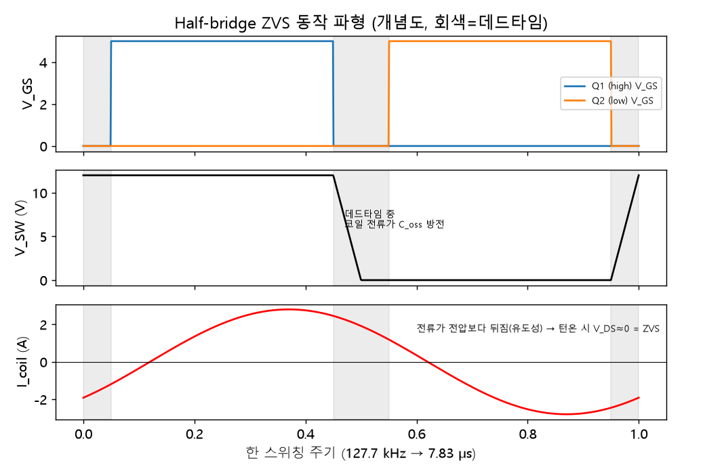 |
| 35 | H-bridge MOSFET 손실 추정 | 반도체소자 | 계산 (가정값 명시) | 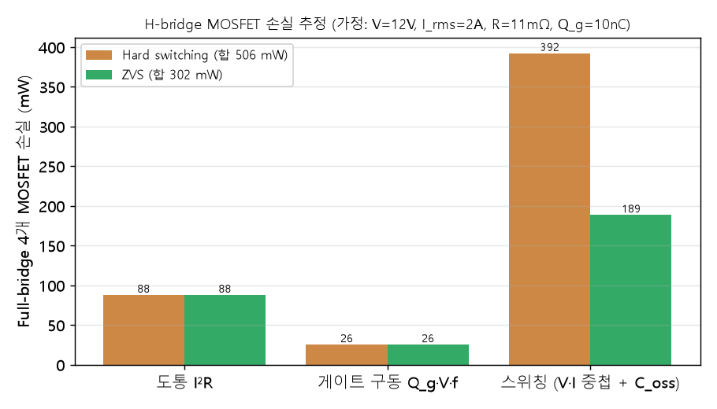 |

**[checker] M = 35, N = 35 → M == N : 예**

> 발표용 보고서: [REPORT.md](REPORT.md) (슬라이드 번호와 1:1 대응)

### 한계 / 추가 확인 필요
- IDTP9236, ABOV 94B428, S3FW6MA는 **공개 데이터시트 없음** → 동일 계열(P9243-GB) 기반 추정
- SoC **다이(die) 레이아웃 사진은 공개 자료 없음** → 기능 블록도 + 핀 배치 + 보드 레이아웃으로 대체 (디캡 촬영 필요 시 별도)
- MP28167-A의 Vbridge 지령 주체(IDTP9236 PWM vs MCU I²C)는 회로 추적 필요
- 실제 Rx 수신전력·온도는 미측정 → 효율 77 %는 상한 추정치

## Step 5. Companies
- Samsung
- Renesas
- MPS
- ABOV

## Step 6. Tech Tree
- 전력전자
- 반도체소자
- 전자기학
- 회로설계
